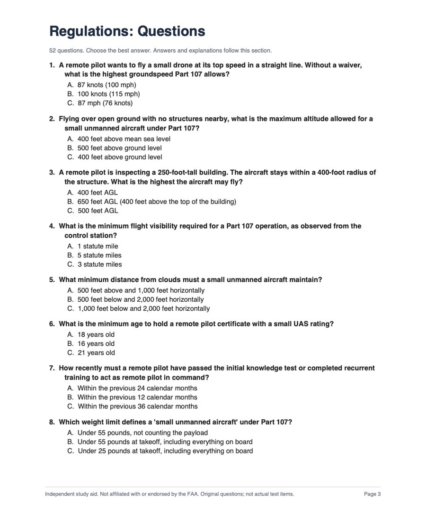
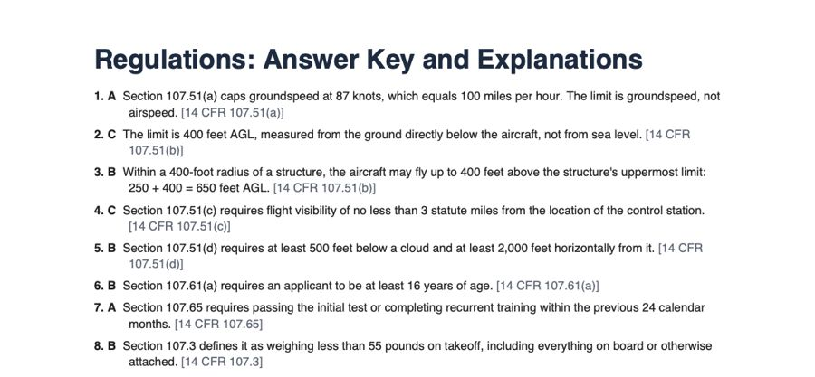
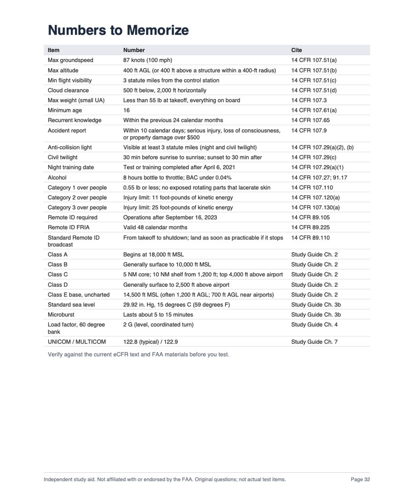

# Part 107 practice questions (free, with explanations)

**Printable version:** [Part107-Free-Sample-20-Questions.pdf](Part107-Free-Sample-20-Questions.pdf) (the same 20 questions with an answer key and citations).

20 original practice questions for the FAA Part 107 remote pilot knowledge test (UAG), each with the correct answer, a short explanation and the 14 CFR section, FAA study-guide chapter or Airman Certification Standards (ACS) code it comes from. The same questions run as an interactive quiz at **[sentry-part107.judestrahm.workers.dev](https://sentry-part107.judestrahm.workers.dev/)**.

- `questions.json`: the 20 questions as JSON (`area`, `question`, `choices`, `answer`, `explanation`, `ref`)
- Timed 20-question mock exam with a different set: [https://sentry-part107.judestrahm.workers.dev/practice-test/](https://sentry-part107.judestrahm.workers.dev/practice-test/)
- Test format, retakes and next steps: [https://sentry-part107.judestrahm.workers.dev/test-faq/](https://sentry-part107.judestrahm.workers.dev/test-faq/)
- Numbers to memorize: [https://sentry-part107.judestrahm.workers.dev/cheat-sheet/](https://sentry-part107.judestrahm.workers.dev/cheat-sheet/)

Independent study aid. Not affiliated with or endorsed by the FAA. These are original questions, not actual test items. Rules change: check the current regulations on [eCFR](https://www.ecfr.gov/current/title-14/chapter-I/subchapter-F/part-107) before your test.

<!-- full-bank:start -->
## The full practice bank ($19)

These 20 questions are a sample. The full bank is a 32-page PDF with **150 questions**, each with the answer, an explanation and its source (14 CFR section, FAA study guide chapter or ACS task code), plus a one-page sheet of numbers to memorize. One-time $19, instant download after checkout: **[get the full Part 107 practice bank](https://buy.stripe.com/fZu8wReAXfvLdXB9V1aR20n)**.

| Area | Questions | Pages |
|---|---|---|
| Regulations | 52 | 3 to 11 |
| Airspace and operating requirements | 30 | 12 to 17 |
| Weather | 20 | 18 to 21 |
| Loading and performance | 12 | 22 to 24 |
| Operations | 36 | 25 to 31 |
| Numbers to memorize | | 32 |

Three real pages from the PDF:

| Page 3: Regulations, questions 1 to 8 | Page 9: answers with 14 CFR citations | Page 32: numbers to memorize |
|---|---|---|
|  |  |  |

No sectional chart images: chart questions describe the chart in words, so use the FAA testing supplement (FAA-CT-8080-2, free from the FAA) alongside it.
<!-- full-bank:end -->

<!-- study-guides:start -->
## Study guides on the site

Free topic guides with worked examples, all at [sentry-part107.judestrahm.workers.dev](https://sentry-part107.judestrahm.workers.dev/):

- [Part 107 airspace practice questions (free, with answers)](https://sentry-part107.judestrahm.workers.dev/airspace/)
- [Part 107 weather and METAR practice questions (free, with answers)](https://sentry-part107.judestrahm.workers.dev/weather/)
- [Part 107 regulations practice questions (free, with answers)](https://sentry-part107.judestrahm.workers.dev/regulations/)
- [Part 107 operations practice questions (free, with answers)](https://sentry-part107.judestrahm.workers.dev/operations/)
- [Part 107 loading and performance practice questions (free, with answers)](https://sentry-part107.judestrahm.workers.dev/loading-performance/)
- [Part 107 METAR and TAF practice questions (free, with answers)](https://sentry-part107.judestrahm.workers.dev/metar-taf/)
- [Part 107 night, operations over people and Remote ID questions (free, with answers)](https://sentry-part107.judestrahm.workers.dev/night-over-people-remote-id/)
- [Part 107 accident reporting and alcohol rule questions (free, with answers)](https://sentry-part107.judestrahm.workers.dev/accident-reporting-alcohol/)
- [Part 107 cheat sheet: the numbers to memorize (with the rule for each)](https://sentry-part107.judestrahm.workers.dev/cheat-sheet/)
- [Part 107 test FAQ: questions, passing score, retakes and next steps](https://sentry-part107.judestrahm.workers.dev/test-faq/)
- [How to read a sectional chart for the Part 107 test (symbols and airspace)](https://sentry-part107.judestrahm.workers.dev/sectional-chart/)
- [Part 107 airport operations: traffic patterns, runways, CTAF and radio calls](https://sentry-part107.judestrahm.workers.dev/airport-operations/)
- [Part 107 Practice Exam: Free Timed 20-Question Mock Test](https://sentry-part107.judestrahm.workers.dev/practice-test/)
<!-- study-guides:end -->

## Questions

**1. What is the minimum flight visibility required for a Part 107 operation, as observed from the control station?** _(Regulations)_

- A. 1 statute mile
- B. 5 statute miles
- C. 3 statute miles

Answer

**C.** Section 107.51(c) requires flight visibility of no less than 3 statute miles from the location of the control station. Source: 14 CFR 107.51(c).

**2. During which period may a small UAS be flown without anti-collision lighting?** _(Regulations)_

- A. Between official sunrise and official sunset
- B. During civil twilight, if the sky is clear
- C. Within 30 minutes after official sunset

Answer

**A.** Anti-collision lighting is required at night and during civil twilight. Daytime means between official sunrise and sunset. Source: 14 CFR 107.29.

**3. Which describes the visual line of sight rule?** _(Regulations)_

- A. The pilot may use binoculars to watch the aircraft at long range
- B. The pilot (or visual observer) must see the aircraft with unaided vision, other than corrective lenses
- C. The pilot may rely on the camera feed if the aircraft is under 400 feet

Answer

**B.** Section 107.31 requires the aircraft to be seen with vision unaided by anything other than corrective lenses (glasses or contacts). Source: 14 CFR 107.31.

**4. What blood alcohol concentration or higher prohibits a person from acting as a remote pilot?** _(Regulations)_

- A. 0.08 percent
- B. 0.04 percent
- C. 0.10 percent

Answer

**B.** Part 91.17, which Part 107 applies, prohibits flying with a blood alcohol concentration of 0.04 percent or greater. Source: 14 CFR 107.27; 91.17(a)(4).

**5. A remote pilot sees a crewed helicopter approaching at low altitude. What does the right-of-way rule require?** _(Regulations)_

- A. Continue, because the drone is smaller
- B. Yield and stay well clear of the helicopter
- C. Pass in front of it quickly

Answer

**B.** Section 107.37 requires a small UAS to yield the right of way to all other aircraft and not pass over, under, or ahead of them unless well clear. Source: 14 CFR 107.37.

**6. Which statement about Category 4 operations over people is correct?** _(Regulations)_

- A. The aircraft must weigh 0.55 pounds or less
- B. The aircraft must hold a Part 21 airworthiness certificate and be flown under its limits
- C. The aircraft only needs a manufacturer label

Answer

**B.** Category 4 (Section 107.140) requires an aircraft with an airworthiness certificate under Part 21, operated under all its limitations. Source: 14 CFR 107.140.

**7. Which item is a required broadcast message element for standard Remote ID?** _(Regulations)_

- A. The pilot's home address
- B. Control station latitude, longitude and altitude
- C. The aircraft's payload description

Answer

**B.** Section 89.305 lists serial number or session ID, aircraft and control station position, aircraft velocity, a UTC time mark, and emergency status. Source: 14 CFR 89.305.

**8. Which airspace generally extends from the surface to 10,000 feet MSL around the nation's busiest airports?** _(Airspace & Operating Requirements)_

- A. Class B
- B. Class C
- C. Class D

Answer

**A.** Class B generally extends from the surface to 10,000 feet MSL and is shaped like an upside-down wedding cake. Source: Study Guide Ch. 2; ACS UA.II.A.K1a.

**9. A chart shows a dashed magenta line around a small airport. This most likely depicts:** _(Airspace & Operating Requirements)_

- A. Class D airspace
- B. Class E airspace that begins at the surface
- C. A military operations area

Answer

**B.** A dashed magenta line shows a Class E surface area, in which 107.41 requires ATC authorization. Source: ACS UA.II.A.K1d; 14 CFR 107.41.

**10. Which statement best describes a prohibited area?** _(Airspace & Operating Requirements)_

- A. Flight is allowed with a visual observer
- B. It only affects flights above 5,000 feet
- C. Flight is not allowed for security or other reasons unless special permission is obtained

Answer

**C.** Prohibited areas, such as certain sensitive government sites, bar flight without special permission. Source: ACS UA.I.B.K18.

**11. How should a remote pilot treat a skeletal tower with guy wires on a chart?** _(Airspace & Operating Requirements)_

- A. Fly within 50 feet of the tower for best visibility
- B. Stay well clear horizontally, because the guy wires can extend roughly 1,500 feet from the tower
- C. Ignore it if the tower is lit

Answer

**B.** Guy wires on tall skeletal structures can extend about 1,500 feet horizontally, so the study guide advises staying at least 2,000 feet away. Source: Study Guide Ch. 11.

**12. In the report METAR KPQR 251753Z 24012G22KT 5SM -RA BKN015 OVC030 12/10 A2987, what is the altimeter setting?** _(Weather)_

- A. 2,987 millibars
- B. 298.7 inches of mercury
- C. 29.87 inches of mercury

Answer

**C.** An A followed by four digits is the altimeter setting in inches of mercury, with the decimal after the second digit. Source: Study Guide Ch. 3a.

**13. A fictional TAF includes 'TEMPO 2520/2523 2SM TSRA BKN015CB'. What does TEMPO mean?** _(Weather)_

- A. A permanent change after the stated time
- B. A 40 percent probability of the weather
- C. Temporary fluctuations lasting less than an hour at a time within the period

Answer

**C.** TEMPO indicates temporary fluctuations expected to last less than one hour at a time and, in total, less than half of the period. Source: Study Guide Ch. 3a.

**14. When a cold front passes, what conditions are most often associated with it?** _(Weather)_

- A. Steady warming and calm winds
- B. Unlimited visibility with no clouds for days
- C. Gusty winds, a wind shift, and a drop in temperature

Answer

**C.** Cold fronts bring a shift in wind direction, falling temperatures and often showers or thunderstorms, so conditions can change fast. Source: ACS UA.III.B.K1d.

**15. A remote pilot attaches a heavier camera to the front of a quadcopter without changing anything else. What is most likely?** _(Loading & Performance)_

- A. No change to performance
- B. Center of gravity shifts and flight time and handling change
- C. The aircraft climbs faster

Answer

**B.** Added weight and a shift in balance alter stability and increase power use, reducing endurance. Source: Study Guide Ch. 4; ACS UA.IV.A.K1a.

**16. A small UAS holds an airspeed of 30 knots flying directly downwind in a 10-knot wind. What is its groundspeed?** _(Loading & Performance)_

- A. 20 knots
- B. 40 knots
- C. 30 knots

Answer

**B.** A tailwind adds to airspeed, so groundspeed is 30 + 10 = 40 knots. The Part 107 speed limit applies to groundspeed. Source: 14 CFR 107.51(a); Study Guide Ch. 8.

**17. What does ATIS provide?** _(Operations)_

- A. Live flight instruction
- B. A map of special-use airspace
- C. A recorded broadcast of current airport weather and operational information

Answer

**C.** The Automatic Terminal Information Service is a continuous broadcast of airport conditions such as wind, altimeter, and active runways. Source: ACS UA.V.A.K5.

**18. A UAS loses its GPS signal while in flight. What is the likely consequence?** _(Operations)_

- A. The aircraft may drift because it cannot hold position, so the pilot may need to fly manually
- B. The aircraft will always land safely by itself
- C. The aircraft gains range

Answer

**A.** Without GPS, many aircraft lose position hold and may drift with the wind, requiring pilot input. Source: ACS UA.V.C.K4.

**19. A pilot says, 'Regulations are for someone else; I know better.' Which hazardous attitude is this, and what is its antidote?** _(Operations)_

- A. Macho: 'Taking chances is foolish'
- B. Resignation: 'I'm not helpless'
- C. Anti-authority: 'Follow the rules; they are usually right'

Answer

**C.** Anti-authority attitudes disregard rules, and the antidote is to follow them because they are written for good reasons. Source: Study Guide Ch. 10; ACS UA.V.D.K4.

**20. A pilot has just taken an over-the-counter medicine that causes drowsiness. What should the pilot do?** _(Operations)_

- A. Fly anyway, because it is not a prescription
- B. Not fly until the effects have worn off and it is safe
- C. Take a second dose to counteract it

Answer

**B.** Medications can impair judgment and alertness, and 107.17 prohibits operating when a condition would interfere with safe operation. Source: 14 CFR 107.17; ACS UA.V.E.K3.

## License

Questions and explanations: [CC BY 4.0](https://creativecommons.org/licenses/by/4.0/). Credit with a link to the source site above.
